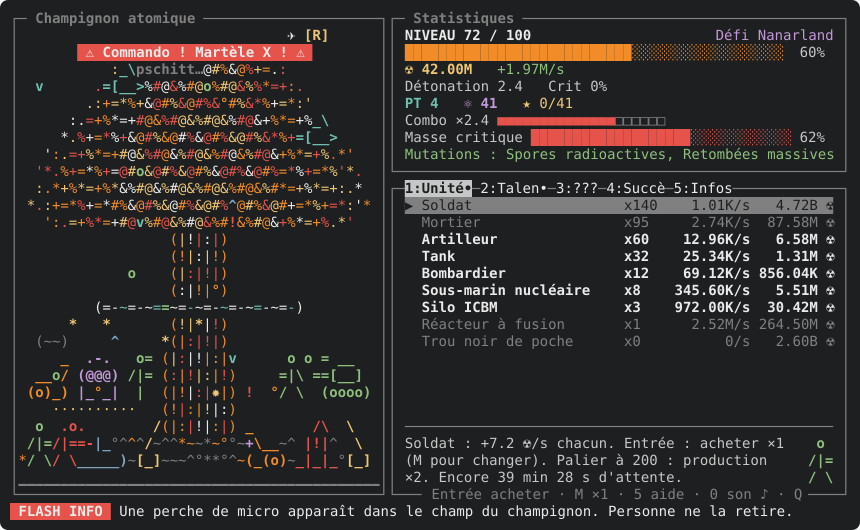

# ☢ CHAMPIGNON ATOMIQUE ☢

> 🎬 *Dans un monde où la radiation est la seule monnaie…*\
> *Un clavier. Un pouce. Une barre d'ESPACE.*\
> *Cet été… le champignon va grossir.*\
> *Et rien… RIEN… ne pourra l'arrêter.*\
> *(sauf peut-être l'inspecteur de l'ONU)*

**UNE PRODUCTION TERMINAL 60×20 FILMS** — en Python 3, curses et stdlib uniquement. Zéro dépendance, zéro
budget, 100 % ASCII. Tourné intégralement en mode texte, sans cascadeur ni fichier audio.

**AVEC, DANS LES RÔLES PRINCIPAUX :**

- 🍄 **LE CHAMPIGNON**, qui grossit à chaque coup de détonateur (ESPACE)… jusqu'à la *surchauffe* !
- 🪖 **L'ARMÉE**, du simple soldat au trou noir de poche, qui crache de la radiation ☢ pendant que tu dors.
- 🧬 **LES MUTATIONS**, spores radioactives, retombées massives et autres horreurs. Réunis la bonne paire et c'est la *synergie*.
- 🕵️ **L'INSPECTEUR DE L'ONU**, venu « vérifier ». Avec ses complices : saboteur, drone, manifestants, commando. Plus le champignon grossit, plus ils viennent souvent et plus ils sont coriaces. Martèle X !
- ✈️ **L'AVION DE RAVITAILLEMENT**, qui ne fait que passer. Tape sa lettre ou adieu le coffre.
- 💥 **LE PRESTIGE ⚛ ET LA SUPERNOVA ✦** : tu meurs, tu recommences, tu reviens *plus fort*. Comme dans toute bonne suite.
- 🎵 **LA BANDE ORIGINALE**, synthétisée en direct, en trois ambiances : calme, tension, épique.

> ⭐⭐⭐⭐⭐ *« J'ai appuyé sur ESPACE pendant quatre heures. »* — un spectateur\
> ⭐⭐⭐⭐⭐ *« Le scénario tient sur un post-it, et c'est très bien comme ça. »* — un autre spectateur\
> 💀 *Déconseillé aux claviers fragiles.*

📸 **Photo de tournage** (terminal 100×30, défi Nanarland : une détonation fait pschitt, un commando approche,
un avion de ravitaillement passe) :



## 🚀 Lancer la projection

```
champignon                 # lance le jeu de n'importe où (menu des parties s'il en existe)
champignon --mute          # sans son
champignon --reset         # efface toutes les parties (après confirmation)
python3 -m unittest        # tests (depuis la racine du projet)
python3 sim.py [runs] [appuis/s]   # simulation sans affichage pour l'équilibrage
python3 apercu.py          # régénère apercu.svg, la capture du README
```

Installation, une fois, depuis le dossier du projet : `./install.sh`. Il crée la commande `champignon` (un
lien vers `main.py` dans `~/.local/bin`, ou le dossier passé en argument) et indique la ligne à ajouter si ce
dossier n'est pas dans le PATH. Seul python3 est requis. `./install.sh --desinstaller` retire la commande
sans toucher aux parties. Sans installer : `./main.py` ou `python3 main.py` depuis le dossier du projet.
Fermer le terminal sauvegarde la partie (SIGHUP/SIGTERM traités comme Ctrl+C).

## 🎮 Le mode d'emploi du détonateur

| Touche | Effet |
|---|---|
| `ESPACE` | Détonateur : radiation ! (gare à la surchauffe) |
| `F` | Masse critique : lance la jauge, puis F au bon moment (vert ×300, jaune ×60) |
| `X` | Chasse l'inspecteur et les ennemis : à marteler |
| *la lettre de l'avion* | Attrape le coffre de ravitaillement |
| `1`-`5`, `Tab`, `←→` | Onglets (ou choix d'un bonus / d'une mutation) |
| `↑↓` / `j k`, `Entrée`, `M` | Sélectionner, acheter, changer la quantité (×1, ×10, ×100, max) |
| `0`, `+` / `-` | Mode son (musique + effets → effets seuls → muet), volume |
| `Q` | Sauvegarde et quitte |

L'aide complète est dans le jeu (touche 5), c'est la liste `ui.KEY_HELP`.

---

🎞️ *Fin de la bande-annonce. Les coulisses, pour faire évoluer le jeu :* 🔧

- [ARCHITECTURE.md](ARCHITECTURE.md) : fichiers, règles, systèmes du jeu, sauvegarde, son, pièges ;
- [RECETTES.md](RECETTES.md) : pas à pas pour ajouter une unité, un ennemi, un défi, un son, une touche…
